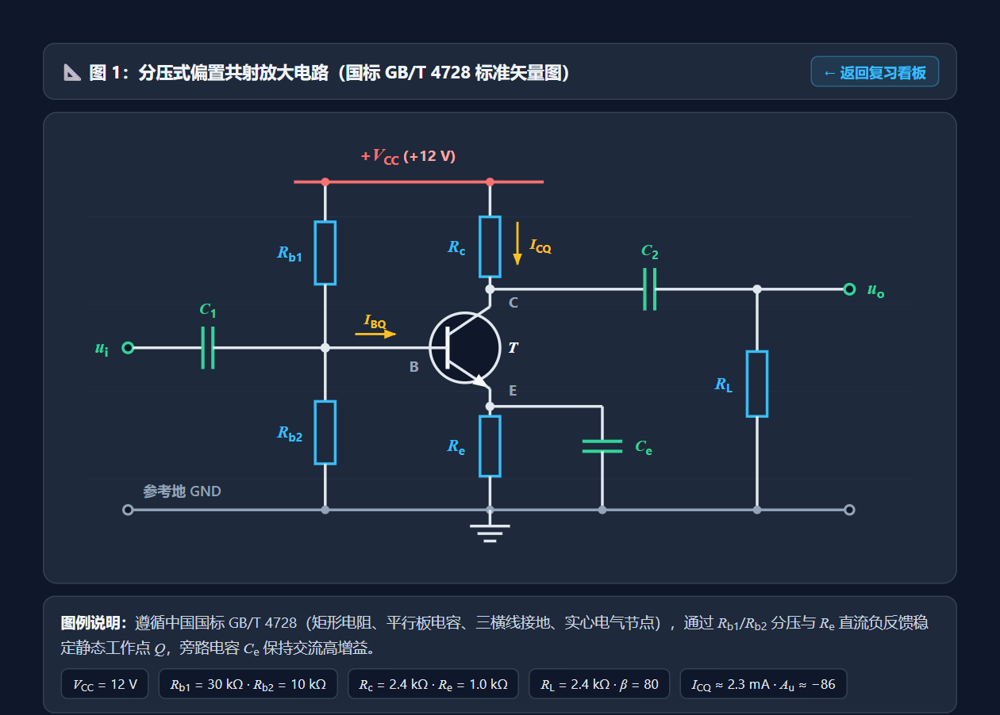
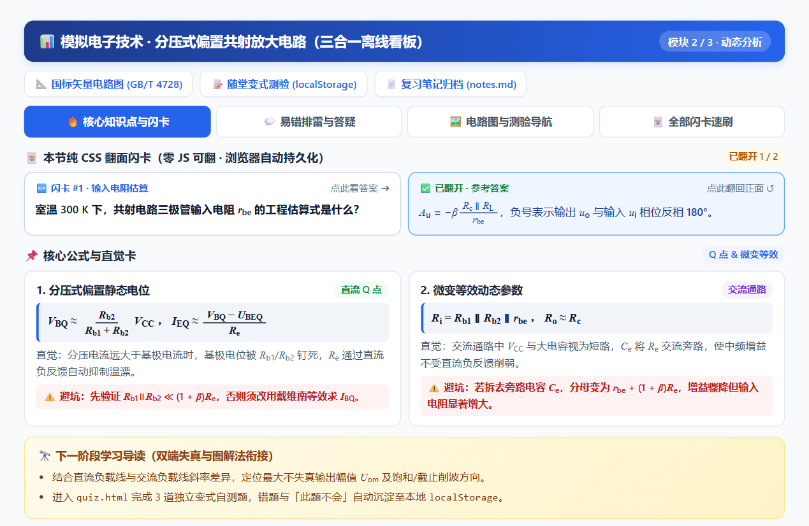
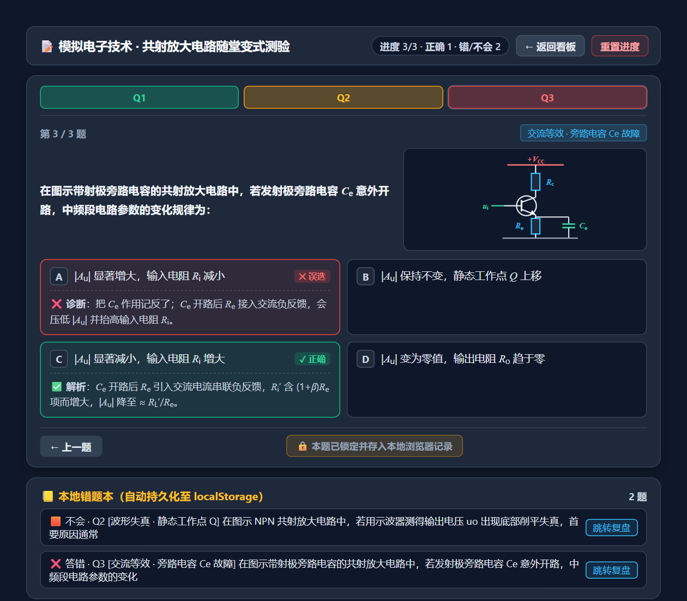

# STEM Circuit & Notes Skill (`stem-circuit-notes-skill`)

[](./LICENSE)
[](https://agentskills.io)
[](#features)
[](#usage-example)

> **Maintenance Policy (Released As-Is)**
>
> This repository is shared freely under the MIT License **as-is** for community reference and self-hosted customization. Issues, Discussions, Wiki, and Projects are intentionally disabled, and there is no active maintenance commitment or support SLA. Feel free to fork and adapt it for your own courses and AI coding assistants.

[中文文档 (README_ZH.md)](./README_ZH.md)

A self-contained, bilingual (Chinese & English) **Agent Skills** pack (`agentskills.io` standard) for **STEM & analog electronics exam-targeted self-study, lecture note review, textbook-standard vector circuit diagram rendering (`GB/T 4728` & `IEEE/IEC`), pure-CSS offline review boards, `localStorage` interactive quizzes, and deterministic quality gates**.

Built around the **Code-as-Memory** pattern: instead of stuffing fragile styling and quiz rules into long prompts, layout templates (`resources/*.html`) and a fast (<50 ms) deterministic linter (`scripts/notes_quality_gate.py`) enforce publication-grade typography, pure SVG schematics, balanced multiple-choice options, and zero-network offline persistence automatically.

---

## Visual Preview

All previews below are rendered directly from the repository's self-contained offline templates and pass `notes_quality_gate.py` with zero external requests or backend servers.

### 1. Textbook-Standard Vector Circuit Diagram (`GB/T 4728` / `IEEE/IEC`)


*Pure-SVG schematic of a classic voltage-divider common-emitter BJT amplifier (GB/T 4728 rectangular resistors, parallel-plate capacitors, 3-bar ground, collision-checked labels, and a structured legend strip).*

### 2. Three-in-One Pure-CSS Offline Review Board


*100% static HTML with pure-CSS tabs and interactive flip flashcards (works even in script-restricted previewers), print-grade HTML math fractions, pitfall callouts, and progressive `localStorage` flip-state persistence.*

### 3. Offline Interactive Quiz & `localStorage` Mistake Notebook


*Per-question immutable lock after answering, a "Don't Know" button, side-by-side mini SVG circuit schematics, option-level diagnostics, live score tracking, and a persistent offline `localStorage` Mistake Notebook.*

---

## Quick Installation

### One-Line Install (Recommended — `agentskills.io` Compatible)

```bash
npx skills add lyrics0097/stem-circuit-notes-skill
```

Natively compatible with **Qoder**, **Claude Code**, **Cursor**, **Codex**, **GitHub Copilot**, **Gemini CLI**, and any AI coding assistant that follows the open `agentskills.io` Agent Skills specification.

<details>
<summary><strong>Manual Installation via <code>git clone</code> (Qoder / Claude Code / Cursor / Codex)</strong></summary>

Clone the repository and copy the language variant you want (`skills/stem-notes-en` or `skills/stem-notes-zh`) into your agent's skill directory:

**Qoder CLI / Qoder IDE (Linux / macOS):**

```bash
git clone https://github.com/lyrics0097/stem-circuit-notes-skill.git

# English STEM skill (IEEE / IEC standard)
mkdir -p .qoder/skills
cp -r stem-circuit-notes-skill/skills/stem-notes-en .qoder/skills/

# Or Chinese STEM skill (GB/T 4728 standard)
cp -r stem-circuit-notes-skill/skills/stem-notes-zh .qoder/skills/
```

**Windows PowerShell:**

```powershell
git clone https://github.com/lyrics0097/stem-circuit-notes-skill.git
New-Item -ItemType Directory -Force -Path ".qoder\skills" | Out-Null
Copy-Item -Recurse -Force "stem-circuit-notes-skill\skills\stem-notes-en" ".qoder\skills\stem-notes-en"
```

**Other Agent Skill Directories:**

- **Claude Code**: `.claude/skills/stem-notes-en/` (or `stem-notes-zh/`)
- **Cursor**: `.cursor/skills/stem-notes-en/` (or `stem-notes-zh/`)
- **Codex**: `.codex/skills/stem-notes-en/` (or `stem-notes-zh/`)

</details>

---

## Features

- **Cross-Agent `agentskills.io` Architecture**: Standard `SKILL.md` YAML frontmatter + self-contained `resources/` and `scripts/` directories with zero external runtime dependencies.
- **Bilingual Dual-Standard Variants**:
  - `skills/stem-notes-zh/` — Chinese STEM & analog electronics skill following **GB/T 4728** rectangular resistor & national-standard circuit diagram conventions.
  - `skills/stem-notes-en/` — English STEM & analog electronics skill following **IEEE/IEC** circuit diagram and physics field conventions.
- **Four Standalone Offline Deliverables (Zero Backend Required)**:
  - `board.html` — Three-in-one study review board with pure-CSS radio tabs & checkbox flashcards plus progressive `localStorage` persistence.
  - `diagrams/fig_*.html` — Standalone, high-DPI pure-SVG circuit diagrams and geometric field sketches with legend strips and collision-checked symbol labels.
  - `quiz.html` — Interactive variant quiz with per-question immutable lock after answering, a **"Don't Know"** button, instant option-level diagnostics, live score tracking, and a **`localStorage`-backed Mistake Notebook** (100% offline, zero external requests).
  - `notes.md` — Clean Markdown + LaTeX archive notes guarded against common parser pitfalls (prime-sign leaks, raw pipe `|` inside GFM table math, unsupported table macros).
- **Deterministic Code-as-Memory Quality Gate (`scripts/notes_quality_gate.py`)**:
  - Validates SVG purity (no HTML tags inside `<svg>`, concise labels, zero `<text>` coordinate overlap, one deterministic topology per figure).
  - Validates print-grade HTML math (blocks raw `^`, `_`, and unescaped `\frac` leaks).
  - Validates quiz integrity (2x2 compact option grid, 4 balanced options, no single-option parenthetical spoilers, immutable CSS lock, offline `localStorage` persistence, circuit diagrams required for circuit-topology questions).
  - Validates Markdown LaTeX safety and zero-leak output hygiene.

---

## Repository Structure

```text
stem-circuit-notes-skill/
├── LICENSE
├── README.md
├── README_ZH.md
├── assets/
│   ├── preview-schematic.png              # GB/T 4728 vector circuit diagram preview
│   ├── preview-board.png                  # Three-in-one pure-CSS review board preview
│   └── preview-quiz.png                   # Offline localStorage quiz & mistake notebook preview
└── skills/
    ├── stem-notes-zh/                     # Chinese STEM Skill (GB/T 4728 circuit standard)
    │   ├── SKILL.md
    │   ├── resources/
    │   │   ├── board_template.html
    │   │   ├── quiz_template.html
    │   │   └── svg_diagram_template.html
    │   └── scripts/
    │       └── notes_quality_gate.py
    └── stem-notes-en/                     # English STEM Skill (IEEE/IEC circuit standard)
        ├── SKILL.md
        ├── resources/
        │   ├── board_template.html
        │   ├── quiz_template.html
        │   └── svg_diagram_template.html
        └── scripts/
            └── notes_quality_gate.py
```

---

## Usage Example

After installing the skill in your workspace, ask your AI agent to teach a STEM or analog electronics topic and generate the offline study package:

```text
Use the stem-notes-en skill to walk through a classic NPN BJT voltage-divider
common-emitter amplifier (DC Q-point estimation and small-signal voltage gain Av).
Generate board.html, diagrams/fig_01_bjt_ce.html, quiz.html, and notes.md,
then run the quality gate script to verify all outputs.
```

Run the deterministic quality gate manually at any time (Python 3.10+, standard library only):

```bash
python .qoder/skills/stem-notes-en/scripts/notes_quality_gate.py .
```

Open `board.html`, `diagrams/fig_*.html`, and `quiz.html` directly in any modern browser — no web server or internet connection required.

---

## License

MIT License — Copyright (c) 2026 [lyrics0097](https://github.com/lyrics0097).
