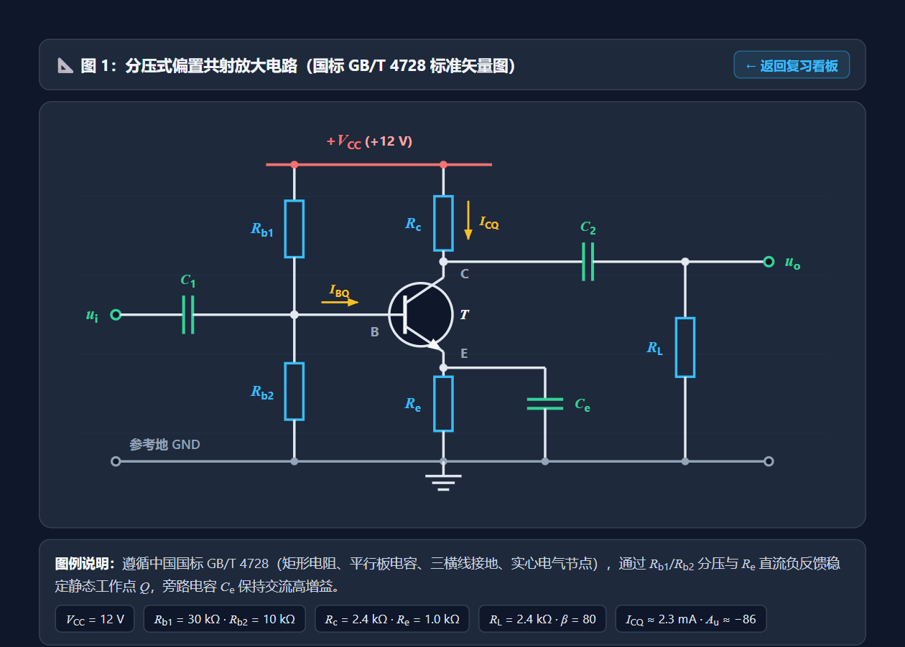
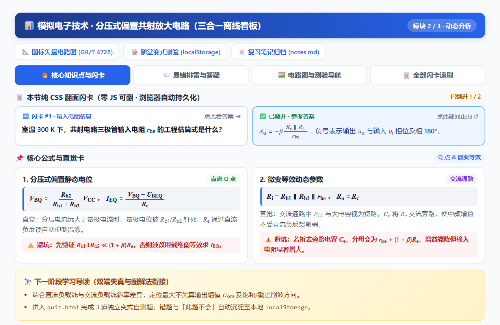
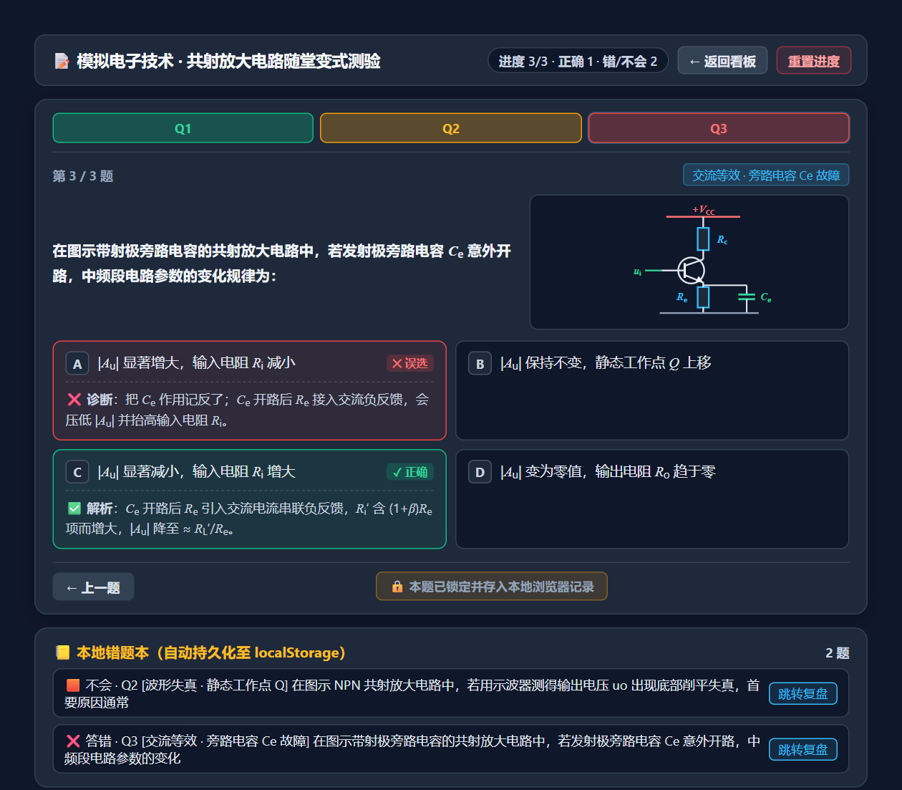

# 理工科电路图与笔记靶向自学技能（`stem-circuit-notes-skill`）

[](./LICENSE)
[](https://agentskills.io)
[](#核心特性)
[](#使用示例)

> **维护声明（按现状开源发布）**
>
> 本仓库基于 MIT 协议**按现状免费开源分享**，仅供社区学习参考与自主二次改造。仓库已主动关闭 Issues、Discussions、Wiki 与 Projects，不提供持续维护承诺或工单支持；欢迎直接 Fork 按自身课程需求自由修改使用。

[English Documentation (README.md)](./README.md)

一套自包含、中英双语、遵循 `agentskills.io` 开放规范的 **Agent Skills** 理工科学习技能包，面向模拟电子技术（analog electronics）及各类理工科课程，覆盖**「教材/考纲靶向自学 + 课堂笔记整理 + 国标 GB/T 4728 / IEEE/IEC 标准矢量电路图（circuit diagram）绘制 + 纯 CSS 三合一离线复习看板 + 纯离线 `localStorage` 交互式随堂测验 + 确定性质量门禁」**全流程。

核心设计采用 **代码即记忆（Code-as-Memory）** 范式：将排版样式、状态机、国标/IEEE 图形原语与防呆断言下沉到 `resources/*.html` 模板与 `<50ms` 确定性校验脚本 `scripts/notes_quality_gate.py`，显著降低长提示词带来的注意力稀释。

---

## 效果预览

以下三张预览图均直接由本仓库自带离线模板渲染生成，全部通过 `notes_quality_gate.py` 质量门禁，零后端依赖、双击浏览器即可离线打开。

### 1. 标准矢量电路图（国标 `GB/T 4728` / `IEEE/IEC`）


*纯 SVG 矢量绘制的经典分压式偏置共射放大电路（国标 GB/T 4728 矩形电阻、平行板电容、三横线接地、零碰撞文字标注与底部参数图例栏）。*

### 2. 三合一纯 CSS 离线复习看板


*100% 静态 HTML 预渲染 + 纯 CSS 切 Tab 与翻面闪卡（无脚本沙箱也可正常翻卡），内置印刷级数学分数排版、高频避坑红条与浏览器 `localStorage` 自动翻卡记忆。*

### 3. 纯离线 `localStorage` 随堂测验与错题本


*单题作答不可逆锁定、「❓ 此题不会」一键入错题本、左文右图迷你国标电路、误选/正确双解析即时展开、实时得分统计与本地持久化错题本。*

---

## 快速安装

### 一行命令安装（推荐 · 兼容 `agentskills.io` 生态）

```bash
npx skills add lyrics0097/stem-circuit-notes-skill
```

原生兼容 **Qoder**、**Claude Code**、**Cursor**、**Codex**、**GitHub Copilot**、**Gemini CLI** 等遵循 `agentskills.io` 开放规范的主流 AI 编程代理。

<details>
<summary><strong>手动克隆安装（<code>git clone</code> 离线拷贝方式）</strong></summary>

克隆仓库后，将对应语言的自包含技能目录（`skills/stem-notes-zh` 或 `skills/stem-notes-en`）复制到你的 AI 工具技能目录即可：

**Qoder CLI / Qoder IDE（Linux / macOS）：**

```bash
git clone https://github.com/lyrics0097/stem-circuit-notes-skill.git
mkdir -p .qoder/skills
cp -r stem-circuit-notes-skill/skills/stem-notes-zh .qoder/skills/
```

**Windows PowerShell：**

```powershell
git clone https://github.com/lyrics0097/stem-circuit-notes-skill.git
New-Item -ItemType Directory -Force -Path ".qoder\skills" | Out-Null
Copy-Item -Recurse -Force "stem-circuit-notes-skill\skills\stem-notes-zh" ".qoder\skills\stem-notes-zh"
```

**其他 AI 代理技能目录：**

- **Claude Code**：`.claude/skills/stem-notes-zh/`
- **Cursor**：`.cursor/skills/stem-notes-zh/`
- **Codex**：`.codex/skills/stem-notes-zh/`

</details>

---

## 核心特性

- **主流 AI 代理标准兼容**：遵循 `agentskills.io` 开放规范（标准 `SKILL.md` YAML frontmatter + 自包含 `resources/` 与 `scripts/`），兼容 **Qoder CLI / IDE**、**Claude Code**、**Cursor**、**Codex**、**GitHub Copilot** 与 **Gemini CLI**。
- **双语双标准独立变体**：
  - `skills/stem-notes-zh/` — 中文理工科版，遵循 **中国国标 GB/T 4728** 矩形电阻、标准运放、三横线接地、实心节点等电路制图规范。
  - `skills/stem-notes-en/` — 英文 STEM 版，遵循 **IEEE/IEC** 电路图（circuit diagram）与物理场图规范。
- **四大通用离线工作区产物（零后端依赖、双击浏览器即用）**：
  - `board.html` — 三合一全局复习看板：100% 静态 HTML 预渲染 + 纯 CSS 切 Tab 与翻面闪卡（无脚本沙箱也能正常展示）+ 浏览器渐进式 `localStorage` 翻卡记忆 + 知识进度与电路图/测验导航。
  - `diagrams/fig_*.html` — 独立高清矢量电路图/几何示意图 HTML：纯 SVG 画布 + 下方清晰图例说明，自动拦截文字碰撞重叠与模糊拓扑混画。
  - `quiz.html` — 交互式随堂变式测验：单题作答后纯 CSS + JS 双重锁定、内置「❓ 此题不会」按钮、逐项误选诊断解析、实时得分统计与纯前端 **`localStorage` 持久化错题本**（零网络请求、离线可用）。
  - `notes.md` — 规范化 Markdown + LaTeX 复习归档笔记，自动拦截公式撇号漏编译、GFM 表格裸竖线 `|` 劈裂公式等常见排版事故。
- **Code-as-Memory 确定性质量门禁（`scripts/notes_quality_gate.py`，仅需 Python 3.10+ 标准库）**：
  - 校验 SVG 纯净度（禁混入 HTML 标签、单标签与全图汉字上限、两两 `<text>` 坐标防碰撞、一图一拓扑防“或/可选”混画）。
  - 校验 HTML 印刷体数学排版（拦截裸露 `^`、`_` 与未转义 `\frac`）。
  - 校验测验命题质量（2×2 紧凑选项网格、四选项字数对称、禁单选项括号剧透、作答锁定、离线 `localStorage` 持久化、电路拓扑题必配电路图）。
  - 校验 Markdown 公式闭合与零本机路径/零回环网络泄露。

---

## 目录结构

```text
stem-circuit-notes-skill/
├── LICENSE
├── README.md
├── README_ZH.md
├── assets/
│   ├── preview-schematic.png              # 国标 GB/T 4728 标准矢量电路图预览
│   ├── preview-board.png                  # 三合一纯 CSS 离线复习看板预览
│   └── preview-quiz.png                   # 纯离线 localStorage 随堂测验与错题本预览
└── skills/
    ├── stem-notes-zh/                     # 中文理工科版（国标 GB/T 4728 电路规范）
    │   ├── SKILL.md
    │   ├── resources/
    │   │   ├── board_template.html
    │   │   ├── quiz_template.html
    │   │   └── svg_diagram_template.html
    │   └── scripts/
    │       └── notes_quality_gate.py
    └── stem-notes-en/                     # 英文 STEM 版（IEEE/IEC 电路规范）
        ├── SKILL.md
        ├── resources/
        │   ├── board_template.html
        │   ├── quiz_template.html
        │   └── svg_diagram_template.html
        └── scripts/
            └── notes_quality_gate.py
```

---

## 使用示例

安装技能后，在项目目录中直接向 AI 助手发起指令：

```text
请使用 stem-notes-zh 技能讲解模拟电子技术经典例题：基本共射放大电路
（单管 NPN BJT 分压式偏置电路的静态工作点 Q 估算与微变等效电路电压放大倍数 Au 分析）。
请产出 board.html、diagrams/fig_01_bjt_ce.html、quiz.html、notes.md，
并运行技能自带的 scripts/notes_quality_gate.py 完成质量自检。
```

也可随时手动运行确定性质量门禁脚本：

```bash
python .qoder/skills/stem-notes-zh/scripts/notes_quality_gate.py .
```

生成的 `board.html`、`diagrams/fig_*.html` 和 `quiz.html` 均为自包含静态网页，直接双击用浏览器打开即可离线复习与刷题。

---

## 开源协议

MIT License — Copyright (c) 2026 [lyrics0097](https://github.com/lyrics0097)。
